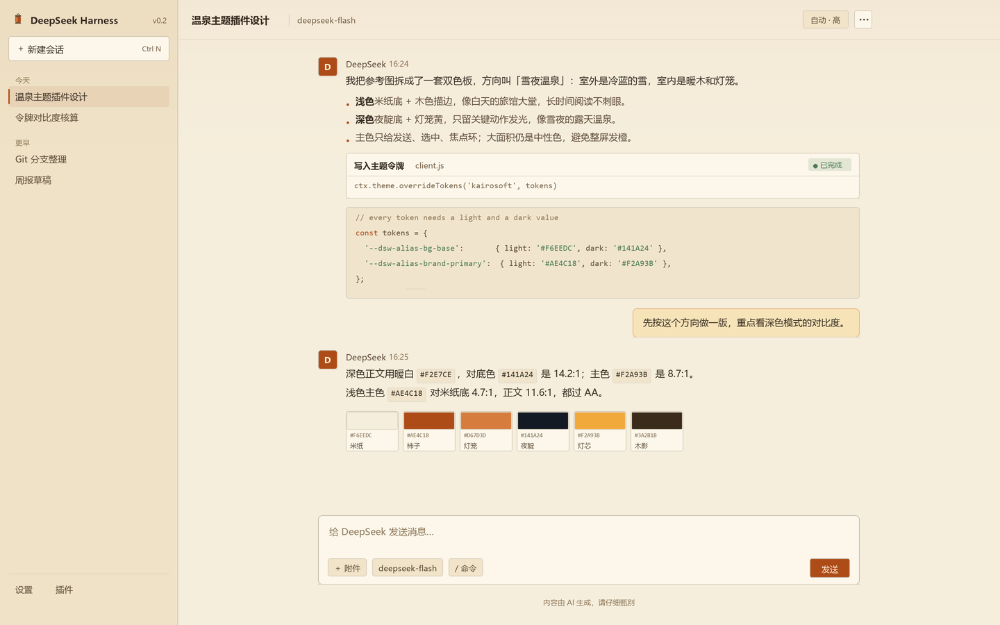
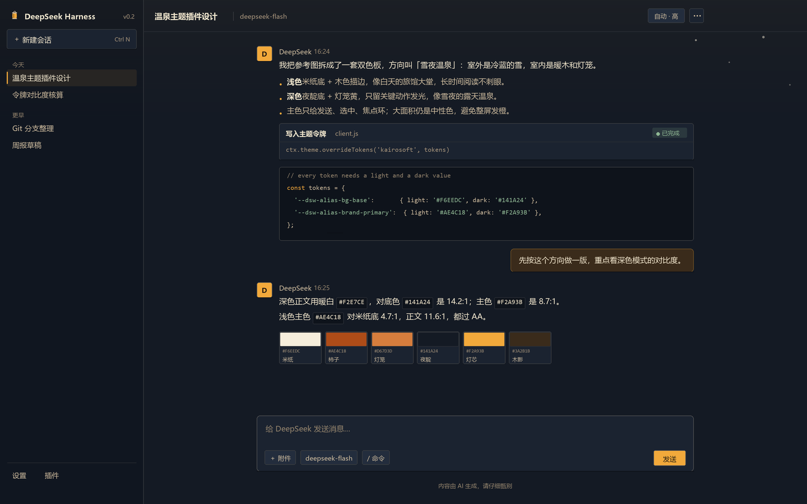
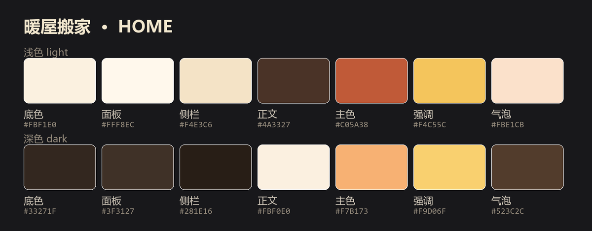
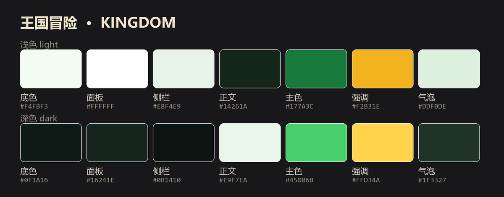
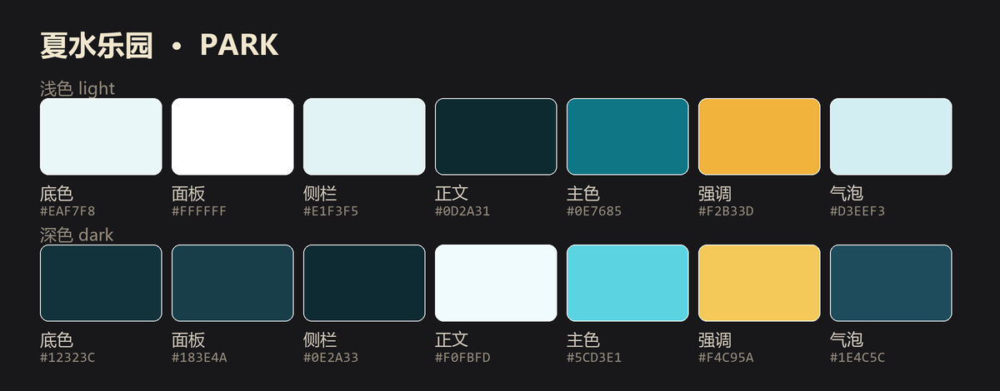
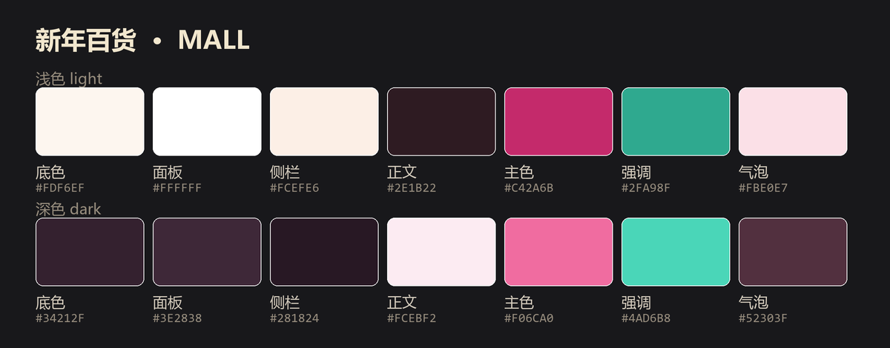
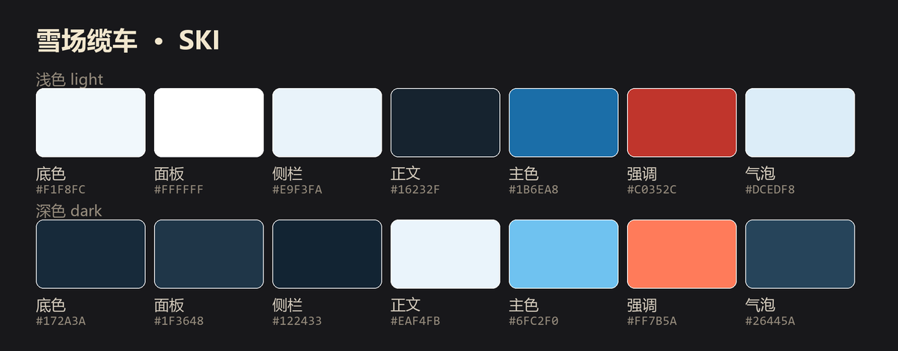

# Kairosoft 主题包

把《温泉物语2》《住宅梦物语》《开罗的游戏王国》《夏日水上乐园物语》《百货商场物语2》《闪耀滑雪场物语》六张宣传图的颜色，做成 DeepSeek Harness 里可以随手切换的六套主题。

- **雪夜温泉**（onsen）：冷蓝雪夜 + 暖木室内 + 灯笼橙
- **暖屋搬家**（home）：奶油墙 + 焦糖木 + 阳光黄
- **王国冒险**（kingdom）：晴空薄荷 + 龙绿 + 火焰黄
- **夏水乐园**（park）：水波青 + 泳池蓝 + 太阳黄
- **新年百货**（mall）：奶油白 + 樱花粉 + 薄荷绿
- **雪场缆车**（ski）：雪白 + 冰蓝 + 旗帜红
- 六套之外还可以**一键回到 DSH 自带的默认主题**









## 特性

- 每个主题 **166 条令牌**覆盖底色、面板、文字、边框、状态、代码、diff、图表、侧栏与输入区
- **宣传图作为整窗背景**，上面压一层米纸 / 夜靛 / 奶油 / 薄荷薄纱，面板半透明浮在画上
- **右下角灯笼按钮**打开调速面板：
  - 七选一主题切换（雪夜温泉 / 暖屋搬家 / 王国冒险 / 夏水乐园 / 新年百货 / 雪场缆车 / 默认）
  - 浅色 / 深色 / 跟随系统三挡明暗切换，和 App 自己的外观设置是同一个开关
  - 面板、侧栏不透明度，背景取景位置，背景开关
  - 侧栏默认与主区同色，可拆开单独调
  - 柔和阴影与底部渐隐默认关掉，可开回
  - 全部实时生效并写进 `localStorage`
- 默认主题走的是「摘掉覆盖」的路径：不注册、不残留，DSH 原生配色原样回来
- 浅色 / 深色**分别设计**，不是简单反色；面板里的明暗按钮调用的是主题服务的 `setTheme()`，会写回 DSH 的外观偏好，重启后仍记得
- 小圆角 + 1px 描边 + 无模糊硬投影，贴近开罗游戏的纸片感
- 主色只出现在发送、选中、焦点、链接上，视觉面积小于 5%
- 禁用插件或热替换时通过 `ctx.effect` 自动还原，不留残色

## 安装

按你手上的东西选一种：

- **插件市场**：侧栏「插件」→「添加插件」→ 搜 `dsh-kairosoft-theme`（已提交 [awesome-dsh-plugin#17920](https://github.com/awesome-dsh-plugin/awesome-dsh-plugin/pull/17920)，收录后直接可见）
- **GitHub 仓库**：`dsh plugin --profile <你的 profile> add https://github.com/carreyda/dsh-kairosoft-theme`
- **本地目录**：侧栏「插件」→「添加插件」→「安装第三方插件」→ 填本仓库的绝对路径（例如 `D:\Github\dsh-kairosoft-theme`）

npm 包尚未发布；发布后再补 `dsh plugin add dsh-kairosoft-theme` 这一种。

装完启用即可在任意会话中看到新配色；切换 `light / dark / system` 会即时生效。
替换已安装包的内容后，需要重启 DeepSeek Harness 才会加载新的 `client.js`。

## 开发

```bash
# 重新生成 client.js、docs/design/tokens.json、docs/design/mockup.html
node scripts/build.mjs

# 重新绘制浅/深两张效果图（需要 Pillow）
python scripts/mockup.py light docs/design/preview-light.png
python scripts/mockup.py dark  docs/design/preview-dark.png
python scripts/palette-card.py kingdom docs/design/kingdom-palette.png
python scripts/palette-card.py park docs/design/park-palette.png
python scripts/palette-card.py mall docs/design/mall-palette.png
python scripts/palette-card.py ski docs/design/ski-palette.png

# 结构自检 + 面板运行时冒烟（无依赖）
node scripts/check.mjs
node scripts/smoke-panel.mjs
```

改配色只改 `design/themes.json`，其余全部是派生结果。

## 结构

| 路径 | 说明 |
| --- | --- |
| `design/themes.json` | 六套主题各 24 个基础语义色，唯一来源 |
| `design/background.jpg` | 雪夜温泉背景图（构建时以 data URI 内联进 `client.js`） |
| `design/background-home.jpg` | 暖屋搬家背景图 |
| `design/background-kingdom.jpg` | 王国冒险背景图 |
| `design/background-park.jpg` | 夏水乐园背景图 |
| `design/background-mall.jpg` | 新年百货背景图 |
| `design/background-ski.jpg` | 雪场缆车背景图 |
| `scripts/build.mjs` | 派生令牌并生成产物 |
| `scripts/mockup.py` | Pillow 效果图渲染器（目前画的是雪夜温泉） |
| `scripts/palette-card.py` | 生成单个主题的色板图 |
| `src/runtime.js` | 手写的浏览器半身（主题切换、可调面板、拖拽条测量），构建时填入令牌与 CSS |
| `client.js` | 生成物：令牌 + CSS + 两份背景图 data URI + 面板逻辑 |
| `index.js` | 宿主侧空实现 |
| `cordis.patch.yml` | 组合包插入声明 |
| `locale/{zh,en}.json` | 插件名与详情页入口 |
| `icon.svg` | 36×36 灯笼图标 |
| `docs/preview.svg` | 详情页插图 |
| `docs/design/theme-design.md` | 完整设计文档（色板、对比度、组件规范） |

## 设计

设计概念、色板取值、WCAG 对比度实测、组件规范、取舍与路线图见
[docs/design/theme-design.md](docs/design/theme-design.md)。

## License

代码、图标、插图和六套色板是本项目的原创，按 MIT 授权，© 2026 carreyda（见 [LICENSE](LICENSE)）。

六张背景图是 Kairosoft 的宣传素材，**不属于 MIT 授权范围**，仅随包提供用于本地个人换肤；出处、商标与再分发说明见 [NOTICE](NOTICE)。本项目与 Kairosoft 无隶属关系。
